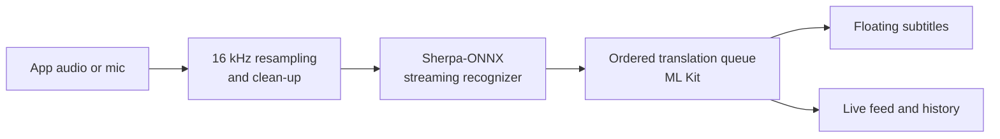

# LiveSub — Live Audio Translator

**Private, offline live subtitles and translation for any app on Android.**

Live subtitles for anything playing on your Android phone. LiveSub listens to a video, stream, game or call, turns the speech into text, translates it, and shows the translation in a floating subtitle box on top of the app you are using.

Speech recognition and translation run on the phone. Audio and text are not sent to a server.

[](https://github.com/R-Dilipkumar/Live-Audio-Translator/releases/latest)
[](LICENSE)
[](https://github.com/R-Dilipkumar/Live-Audio-Translator/stargazers)
[](https://developer.android.com)
[](https://github.com/k2-fsa/sherpa-onnx)
[](https://developers.google.com/ml-kit/language/translation)

<!-- Screenshots: add 2–3 phone screenshots or a short GIF of the overlay here -->

## Why LiveSub

Most live-translation apps send your audio to a cloud service, only listen to the microphone, or show text inside their own app. Google's Live Translate only runs on some phones. LiveSub is different:

- **Subtitles over any app.** A floating box on top of YouTube, games, calls and more.
- **Hears your phone's own audio**, not just the microphone.
- **Fully on the phone.** No account, no API key, no audio uploaded.
- **Live, word by word.** Text appears while people are still speaking.
- **Works on any Android 10+ phone**, not only Pixels.
- **Free and open source** under the MIT license.

If LiveSub is useful to you, please give it a ⭐ — it helps others find it.

## Download

Get the latest APK from [Releases](https://github.com/R-Dilipkumar/Live-Audio-Translator/releases). Open it on your phone and allow installing from that source.

Test builds are signed with a debug key, so Android may warn that the developer is unknown.

## How to use

1. **Download a speech model.** Open **Manage Models** and download the model for the language you will listen to. For Japanese, use **Multilingual**.
2. **Download translation packs.** In the same tab, download the pack for the spoken language and the pack for the language you read.
3. **Pick languages.** On the **Translate** tab, choose the spoken language (or Auto-Detect) and the language to translate to.
4. **Start.** Choose **Internal** (audio from other apps) or **Mic**, press **Start**, and allow screen/audio capture when Android asks.
5. **Open the overlay.** Press **Launch Overlay** to show subtitles on top of other apps. Drag it anywhere; use the gear icon for size, lines and theme.

Some apps block audio capture (DRM-protected video, for example); LiveSub then receives only silence.

## Features

- **Captures app audio or the microphone.** Internal capture uses Android's audio playback capture (Android 10+).
- **Live speech recognition** with streaming Zipformer models from Sherpa-ONNX. Words appear while they are spoken.
- **On-device translation** with Google ML Kit, including automatic detection of the spoken language.
- **Floating subtitles** over any app: draggable, 1–3 lines, adjustable text size, background and themes. The newest words always stay visible.
- **Live feed and history** in the app, saved on the phone. Tap a line to copy it.
- **Quick Settings tile** to start and stop without opening the app.
- **Audio clean-up tuned for speech**: rumble filter, a boost for quiet or husky voices, and an optional noise gate.
- **Simple settings** for subtitles, plus **Developer settings** for recognition tuning (pause length, restart timing, shortest sentence, handling of one-character results) and a recorder that saves exactly what the speech engine hears.

## Speech models

One streaming model per language, downloaded from the official [Sherpa-ONNX model release](https://github.com/k2-fsa/sherpa-onnx/releases/tag/asr-models). Sizes are download sizes.

| Model | Languages | Download | Notes |
|---|---|---|---|
| Multilingual | Japanese, Chinese, English, Russian, Arabic, Thai, Vietnamese, Indonesian | 247 MB | Switches language automatically |
| English | English | 55 MB | Kroko, punctuation and capitals |
| Chinese | Chinese with English | 128 MB | X-ASR, punctuation |
| Spanish | Spanish | 119 MB | Kroko, punctuation and capitals |
| French | French | 55 MB | Kroko, punctuation and capitals |
| German | German | 55 MB | Kroko, punctuation and capitals |
| Korean | Korean | 399 MB | |
| Russian | Russian | 86 MB | Vosk |
| Bengali | Bengali | 83 MB | Vosk |

Kroko models are community models under CC-BY-SA. Other models use their authors' licenses.

Translation packs are Google ML Kit models, about 30 MB each.

## How it works



- **Capture** (`service/AudioCaptureService.kt`): a foreground service reads audio, converts it to 16 kHz mono with an anti-aliasing resampler, and applies the optional filter, boost and gate.
- **Recognition** (`asr/SpeechRecognizerEngine.kt`): feeds audio to Sherpa-ONNX and emits draft and finished sentences in order. Each sentence starts on a fresh stream. `asr/ModelManager.kt` downloads, installs and selects models; each model lives in its own folder.
- **Translation** (`translate/`): one ordered queue with a time limit, ML Kit language detection for Auto-Detect, and clear messages when a language pack is missing.
- **Display** (`overlay/`, `ui/`): the overlay service and the app read the same results; older or out-of-order results are ignored.

## Building

Requirements: JDK 17+, Android SDK (platform 36.1, build-tools 36.1.0) and the NDK. Android Studio is optional.

```bash
git clone https://github.com/R-Dilipkumar/Live-Audio-Translator.git
cd Live-Audio-Translator
```

Create `local.properties` with `sdk.dir=<path to your Android SDK>`. Debug builds are signed with `debug.keystore` in the project root (not in the repository), so create one first, for example with `keytool -genkeypair -keystore debug.keystore -alias androiddebugkey -storepass android -keypass android -keyalg RSA -validity 10000 -dname "CN=Android Debug"`.

```bash
./gradlew assembleDebug              # app/build/outputs/apk/debug/app-debug.apk
./gradlew :app:testDebugUnitTest     # unit tests
```

Release builds read `KEYSTORE_PATH`, `STORE_PASSWORD` and `KEY_PASSWORD` from environment variables.

## Permissions

| Permission | Why |
|---|---|
| Record audio | Capture app audio or the microphone |
| Display over other apps | Show the floating subtitles |
| Foreground service (media projection, microphone) | Keep capturing while you use other apps |
| Notifications | Show the capture notification and errors |
| Internet | Download speech models and translation packs |

## Privacy

- Audio, transcripts and translations are processed on the phone and are not uploaded.
- The internet is used to download models and language packs.
- Google ML Kit may send anonymous usage statistics to Google, as described in its terms.
- History is stored on the phone until you clear it.

## Contributing

Bug reports and pull requests are welcome. Please run `./gradlew :app:testDebugUnitTest` before opening a pull request.

## License

LiveSub's code is released under the [MIT License](LICENSE). Speech models and translation packs are downloaded separately and keep their own licenses (see [Speech models](#speech-models)).
