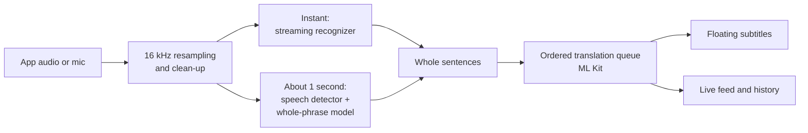

# LiveSub — Offline Translator

**Private, offline live subtitles and translation for any app on Android.**

Live subtitles for anything playing on your Android phone. LiveSub listens to a video, stream, game or call, turns the speech into text, translates it, and shows the translation in a floating subtitle box on top of the app you are using.

Speech recognition and translation run on the phone. Audio and text are not sent to a server.

[](https://github.com/R-Dilipkumar/LiveSub-Offline-Translator/releases/latest)
[](LICENSE)
[](https://github.com/R-Dilipkumar/LiveSub-Offline-Translator/stargazers)
[](https://developer.android.com)
[](https://github.com/k2-fsa/sherpa-onnx)
[](https://developers.google.com/ml-kit/language/translation)

<!-- Screenshots: add 2–3 phone screenshots or a short GIF of the overlay here -->

## Why LiveSub

Most live-translation apps send your audio to a cloud service, only listen to the microphone, or show text inside their own app. Google's Live Translate only runs on some phones. LiveSub is different:

- **Subtitles over any app.** A floating box on top of YouTube, games, calls and more.
- **Hears your phone's own audio**, not just the microphone.
- **Fully on the phone.** No account, no API key, no audio uploaded.
- **Fast or accurate, your choice.** Instant shows words while people speak; About 1 second waits for each phrase and gets far more right, with punctuation.
- **Works on any Android 10+ phone**, not only Pixels.
- **Free and open source** under the MIT license.

If LiveSub is useful to you, please give it a ⭐ — it helps others find it.

## Download

Get the latest APK from [Releases](https://github.com/R-Dilipkumar/LiveSub-Offline-Translator/releases). Open it on your phone and allow installing from that source.

Test builds are signed with a debug key, so Android may warn that the developer is unknown.

## How to use

1. **Download a speech model.** Open the **Models** tab and download a model for the language you will listen to. For Japanese, Chinese or Korean, **SenseVoice** is the most accurate. For live word-by-word text, use **Multilingual**.
2. **Download translation packs.** In the same tab, download the pack for the spoken language and the pack for the language you read. If one is missing, the main screen tells you which.
3. **Pick languages.** On the **Translate** tab, choose the **Spoken language** (or Auto-Detect) and **Subtitles in**. The line below shows which speech model is listening and whether it understands that language.
4. **Start.** Choose **Phone audio** or **Microphone**, press **Start**, and allow audio capture when Android asks. The floating subtitles open by themselves (you can turn that off in Settings).
5. **Use the floating subtitles.** Drag the top bar to move them, drag the corner to resize, and double-tap to hide the controls. The gear icon sets text size, lines (up to 8), how far back you can scroll, style and theme.

**Preferred latency** (Settings): **Instant** uses a streaming model, so words appear while spoken. **About 1 second** uses a whole-phrase model: text appears sentence by sentence, usually within a few seconds, with punctuation and far fewer mistakes. Each latency keeps its own model.

Some apps block audio capture (DRM-protected video, for example); LiveSub then receives only silence.

## Features

- **Captures app audio or the microphone.** Internal capture uses Android's audio playback capture (Android 10+).
- **Two kinds of speech recognition** from Sherpa-ONNX:
  - **Instant:** streaming models; words appear while they are spoken.
  - **About 1 second:** speech is cut into pieces at sentence breaks (judged from the speaker's own rhythm) or, in long non-stop speech, at a gap between words; how long a piece may get depends on how fast the model runs on your phone. A stronger model (SenseVoice, Moonshine, Parakeet, GigaAM or Whisper) recognizes each piece in the background, with punctuation. A translated draft shows right away; the whole sentence replaces it when complete. Music and laughter are ignored, and the model can be locked to the spoken language.
- **Whole-sentence translation:** pieces split by short pauses are joined before translating, so meaning isn't cut in half.
- **On-device translation** with Google ML Kit between 59 languages (including Tamil, Telugu, Kannada, Marathi, Bengali, Gujarati and Urdu), with automatic detection of the spoken language. For speech in Indian languages, use a Whisper model.
- **Floating subtitles** over any app, in three styles:
  - **Roll-up:** lines stack and roll up; scroll back to reread, and it returns to live by itself.
  - **Movie:** whole cards that stay long enough to read.
  - **Live:** one line rewritten as words arrive.
  Each sentence gets its own line or card. Drag the corner to resize it (sideways for width, up or down for up to 8 lines), choose how many past subtitles you can scroll back to (10–200), and change text size, background and themes. Double-tap hides the controls.
- **Live feed and history** in the app, saved on the phone. Tap a line to copy it.
- **Quick Settings tile** to start and stop without opening the app.
- **Audio clean-up tuned for speech**: rumble filter, a boost for quiet or husky voices, and an optional noise gate.
- **Simple settings** for subtitles, plus **Developer settings** for recognition tuning (pause length, restart timing, shortest sentence, handling of one-character results) and a recorder that saves exactly what the speech engine hears.

## Speech models

All models come from the official [Sherpa-ONNX model release](https://github.com/k2-fsa/sherpa-onnx/releases/tag/asr-models) and are downloaded inside the app. Sizes are download sizes.

**Instant** (streaming, words appear while spoken)

| Model | Languages | Download | Notes |
|---|---|---|---|
| Multilingual | Japanese, Chinese, English, Russian, Arabic, Thai, Vietnamese, Indonesian | 247 MB | Switches language automatically |
| English | English | 55 MB | Kroko, punctuation and capitals |
| Chinese | Chinese with English | 128 MB | X-ASR, punctuation |
| Spanish | Spanish | 119 MB | Kroko, punctuation and capitals |
| French | French | 55 MB | Kroko, punctuation and capitals |
| German | German | 55 MB | Kroko, punctuation and capitals |
| Korean | Korean | 399 MB | |
| Russian | Russian | 86 MB | Vosk |
| Bengali | Bengali | 83 MB | Vosk |

**About 1 second** (whole phrases, most accurate)

| Model | Languages | Download | Notes |
|---|---|---|---|
| SenseVoice | Japanese, Chinese, English, Korean, Cantonese | 155 MB | Best for anime and dramas; ignores music and laughter |
| Moonshine | Japanese, English, Chinese, Spanish, Arabic, Vietnamese, Ukrainian, Korean (one model each) | 47–114 MB | Small and fast |
| Parakeet v3 | 25 European languages | 465 MB | NVIDIA, punctuation and capitals |
| GigaAM v3 | Russian | 162 MB | |
| Whisper Base | 99 languages | 198 MB | Hindi, Tamil, Thai, Turkish and more |
| Whisper Small | 99 languages | 610 MB | More accurate, but too slow for live speech on many phones |

About-1-second models also download the Silero speech detector (under 1 MB).

| License | Models |
|---|---|
| Apache-2.0 | Multilingual, Chinese, Korean, Russian (Vosk), Bengali |
| CC-BY-SA (Kroko community) | English, Spanish, French, German |
| FunASR model license | SenseVoice |
| Moonshine Community License | Moonshine |
| CC-BY-4.0 | Parakeet v3 |
| MIT | GigaAM v3, Whisper, Silero speech detector |

Translation packs are Google ML Kit models, about 30 MB each.

## How it works



- **Capture** (`service/AudioCaptureService.kt`): a foreground service reads audio, converts it to 16 kHz mono with an anti-aliasing resampler, and applies the optional filter, boost and gate. It also forwards recognized speech to the translator and saves finished lines to history.
- **Recognition** (`asr/`):
  - `SpeechRecognizerEngine.kt` runs the chosen model and emits draft and finished sentences in order. Instant models use the streaming recognizer; About-1-second models use `OfflinePhraseRecognizer.kt` (Silero speech detector plus a whole-phrase model).
  - `SentenceAssembler.kt` joins pieces into sentences, and `NoiseTextFilter.kt` drops text that is really music or noise.
  - `ModelManager.kt` downloads, installs (only when complete) and selects models; each model lives in its own folder.
- **Translation** (`translate/`): one ordered queue with a time limit, the heard language or ML Kit language detection for Auto-Detect, and clear messages when a language pack is missing.
- **Display** (`overlay/`, `ui/`): the overlay service and the app read the same results; older or out-of-order results are ignored. `overlay/SubtitlePager.kt` times Movie-style cards.

## Building

Requirements: JDK 17+, Android SDK (platform 36.1, build-tools 36.1.0) and the NDK. Android Studio is optional.

```bash
git clone https://github.com/R-Dilipkumar/LiveSub-Offline-Translator.git
cd LiveSub-Offline-Translator
```

Create `local.properties` with `sdk.dir=<path to your Android SDK>`. Debug builds are signed with `debug.keystore` in the project root if it exists (it is not in the repository); otherwise Android's default debug key is used. To make one: `keytool -genkeypair -keystore debug.keystore -alias androiddebugkey -storepass android -keypass android -keyalg RSA -validity 10000 -dname "CN=Android Debug"`.

```bash
./gradlew assembleDebug              # app/build/outputs/apk/debug/app-debug.apk
./gradlew :app:testDebugUnitTest     # unit tests
```

Release builds read `KEYSTORE_PATH`, `STORE_PASSWORD` and `KEY_PASSWORD` from environment variables.

## Permissions

| Permission | Why |
|---|---|
| Record audio | Capture app audio or the microphone |
| Display over other apps | Show the floating subtitles |
| Foreground service (media projection, microphone) | Keep capturing while you use other apps |
| Notifications | Show the capture notification and errors |
| Internet | Download speech models and translation packs |

## Privacy

- Audio, transcripts and translations are processed on the phone and are not uploaded.
- The internet is used to download models (HTTPS only) and language packs. The app has no cloud or analytics SDKs of its own.
- Google ML Kit may send anonymous usage statistics to Google, as described in its terms.
- History is stored on the phone until you clear it. It is left out of Android cloud backups (a phone-to-phone transfer brings it to your new phone). Downloaded models and recorded debug audio are left out of backups and transfers.

## Contributing

Bug reports and pull requests are welcome. Please run `./gradlew :app:testDebugUnitTest` before opening a pull request.

## License

LiveSub's code is released under the [MIT License](LICENSE). Speech models and translation packs are downloaded separately and keep their own licenses (see [Speech models](#speech-models)).

LiveSub uses these open-source libraries:
- [Sherpa-ONNX](https://github.com/k2-fsa/sherpa-onnx) (Apache-2.0) with ONNX Runtime (MIT).
- AndroidX, Jetpack Compose, Room, DataStore, Kotlin coroutines, OkHttp and Apache Commons Compress (Apache-2.0).
- Translation and language detection use [Google ML Kit](https://developers.google.com/ml-kit/terms), under Google's ML Kit terms.
